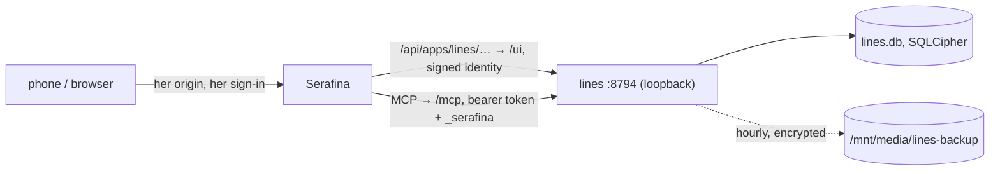

# Lines

An app beside Serafina (serafina/docs/APPS.md): your notes, on a page inside
her and through her tools. Made from her app template.



## Layout

| | |
|---|---|
| `src/lines/auth.py` | Who gets in: her signed identity on `/ui`, her token on `/mcp` |
| `src/lines/secretfile.py` | `secrets.age` |
| `src/lines/db.py` | The encrypted database file and its backups |
| `src/lines/server.py` | The listener, the pages' API, the CSP |
| `src/lines/mcp.py` | The tools |
| `src/lines/notes.py` | The sample's data (replace it) |
| `frontend/` | The pages, in her theme |
| `integration/serafina/` | The skill and her config entries |
| `deploy/` | The unit, backups, deploys, admin |
| `docs/` | Design note, deploy steps, changelog, what's new, TODO |

## Running it locally

```bash
uv sync
export LINES_DATA_DIR=data LINES_USERS=you@example.com LINES_AGE_PASSPHRASE=dev-only
uv run lines secrets init
uv run lines secrets web-key | tail -1      # for the dev proxy below
uv run lines serve                          # 127.0.0.1:8794

cd frontend && npm install
LINES_DEV_APP_KEY=<that key> LINES_DEV_USER=you@example.com npm run dev   # :5174, signs like Serafina
```

Checks: `uv run pytest && uv run ruff check . && (cd frontend && npm run lint)`.
On astarte: [docs/deploy-astarte.md](docs/deploy-astarte.md).

## Serafina's template

Made from Serafina's app template (`serafina/templates/app`; the rules are
her `docs/APPS.md`). From her checkout:

```bash
uv run python scripts/app_template.py new ../lines --name lines --port 8794   # how this repo began
uv run python scripts/app_template.py check ../lines       # where it differs from the template now (--diff, --all)
uv run python scripts/add_app.py /opt/lines/serafina-app.toml   # her config entries (docs/deploy-astarte.md, step 2)
```

`serafina-app.toml` holds this app's values for both, `[paths]` for template
files kept somewhere else here, and `[deviations]` for differences on
purpose, each with its reason. In a file the template shares, the lines
between `this app's own` and `end of this app's own` are this app's (its
other secrets, say); the rest has to match. When the template changes, run
`check` and bring this repo in line.
